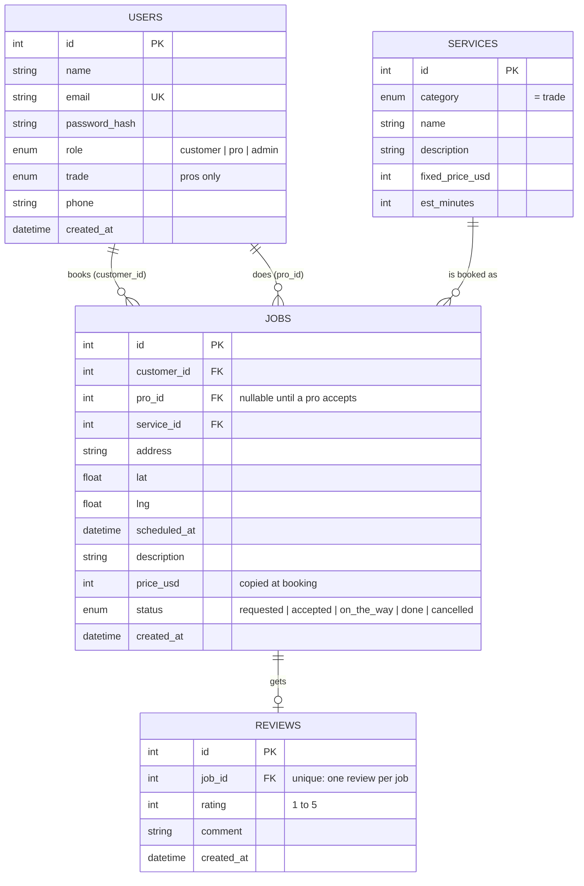

# Fixit - Database schema (final)

PostgreSQL database, managed with Prisma (`server/prisma/schema.prisma`).



## Relationships

| Relation | Type | How |
|---|---|---|
| customer to jobs | 1 to many | `jobs.customer_id` references `users.id` |
| pro to jobs | 1 to many | `jobs.pro_id` references `users.id` (empty until a pro accepts) |
| service to jobs | 1 to many | `jobs.service_id` references `services.id` |
| job to review | 1 to 0..1 | `reviews.job_id` is unique |

## Design decisions

- **`price_usd` is copied into the job when it is booked.** If the catalogue price changes later, old jobs keep the price the customer agreed to.
- **A pro's average rating is calculated, not stored.** It is the average of the ratings on that pro's jobs, so it can never be out of date.
- **Trades are an enum** (plumbing, electrical, ac, carpentry, painting). The same values are used for a pro's trade and a service's category, so "jobs in my trade" is a simple equality check.

## Job status flow

```
requested --(pro accepts)--> accepted --(pro)--> on_the_way --(pro)--> done --(customer)--> review
    |
    +--(customer cancels)--> cancelled
```
